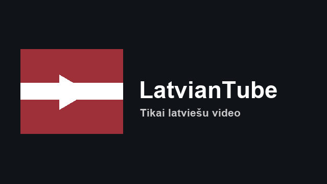
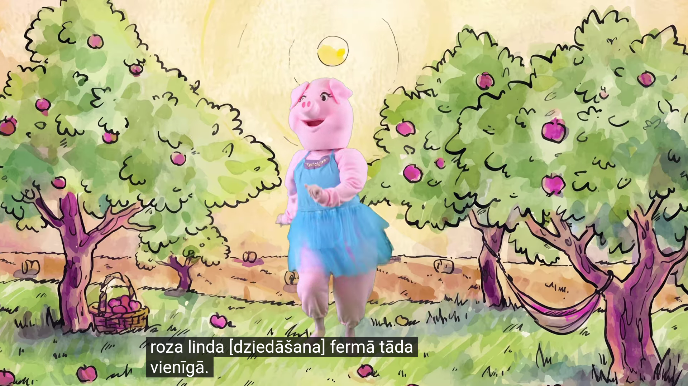
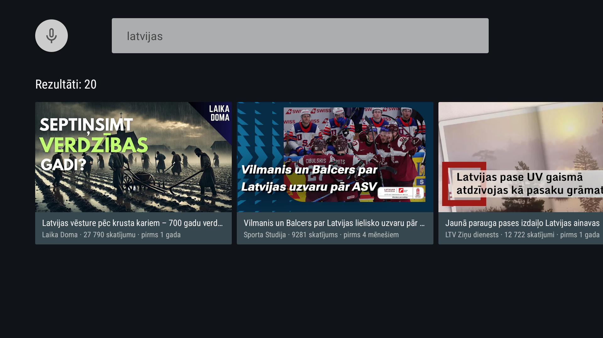

# LatvianTube

An Android TV client that shows **only YouTube content in the Latvian language**.

Built by reverse-engineering and reimplementing the architecture of
[SmartTube](https://github.com/yuliskov/SmartTube) (`yuliskov/SmartTube` @ `486c493`),
scoped to one language instead of everything. The investigation record — questions,
evidence, findings, limitations — is in **[ANALYSIS.md](ANALYSIS.md)**.



---

## What it does

| | |
|---|---|
| **Content** | Latvian-language video only, enforced by a scored language gate |
| **Sources** | 17 verified Latvian channels in 8 categories + Latvian-scoped search |
| **UI** | Leanback TV interface, Latvian by default |
| **Account** | None. Anonymous and stateless — no sign-in, no subscriptions, no history |
| **Playback** | YouTube embedded player in a WebView |

Home screen rows are `Ziņas`, `Mūzika`, `Sports`, `Virtuve`, `Komēdija`,
`Izglītība`, `Kino`, `Pilsētas`.

---

## Build and verification status

**Built, installed, and run on an Android TV emulator.** Everything below was
observed on a running device, not inferred.

| | Home | Playback | Search |
|---|---|---|---|
| |  |  |  |

| Component | Status | Evidence |
|---|---|---|
| Gradle + Java compilation | ✅ **Compiles** | `./gradlew assembleDebug` → BUILD SUCCESSFUL |
| APK structure & TV attributes | ✅ **Verified** | `aapt2 dump badging` / `xmltree` |
| Installs as an Android TV app | ✅ **Verified** | `LEANBACK_LAUNCHER` resolves to `BrowseActivity` |
| Curated registry loads | ✅ **Observed** | 17 channels, 8 categories, 3 exclusions logged |
| Live content through the filter | ✅ **Observed** | 8 rows, **465 retrieved / 461 admitted** |
| Playback | ✅ **Observed** | VP9 MediaCodec decoder created; Latvian captions |
| Search | ✅ **Observed** | `latvijas` → 20 Latvian results, incl. non-curated channels |
| Cache | ✅ **Observed** | Second launch served every row `(cache)` |
| Crashes | ✅ **None** | 0 across all runs |
| Performance on real TV hardware | ✅ **Fixed** | Janky frames 65.98% → **4.30%**; see `ANALYSIS.md` §E11 |
| Latvian filter algorithm | ✅ **Executed** live | `tools/REPORT.md` — 122 videos, 117 admitted, 8/8 fixtures |
| Registry curation | ✅ **Executed** live | `tools/verify-registry.mjs` — 17/17 clean |

### Three defects that only running the app could find

Static analysis passed cleanly on code that did not work. All three were found on
the emulator (details in `ANALYSIS.md` §E8–E9):

1. **`assembleDebug` failed** — `cannot find symbol: class Call`, an OkHttp import
   I removed during a cleanup while the type was still used. `validate_project.py`
   reported "No errors found" on that same code, because it cannot resolve symbols.
2. **The player did not play at all** — YouTube error **153**. The IFrame API
   rejects `file://` origins, and the player page was loaded from
   `file:///android_asset/`. Fixed with `WebViewAssetLoader`, serving the page from
   a real HTTPS origin. No amount of compiling would have revealed this; it is a
   remote service's policy.
3. **Search was unreachable** — the activity existed and was correct, but nothing
   in the UI could open it. Current `BrowseSupportFragment` has no search
   affordance. Fixed with an explicit `Meklēt` row reachable by D-pad.

A fourth, cosmetic: the Leanback search bar rendered **"Speak to search" in
English**. `MotherActivity` now pins the UI locale to `lv-LV`, so the app is
Latvian regardless of the TV's system locale — the right behaviour for a
Latvian-only product. It now reads "Runāt, lai meklētu".

### Reproducing the build and the emulator run

```bash
cd LatvianTube
echo "sdk.dir=$HOME/Library/Android/sdk" > local.properties
./gradlew assembleDebug
adb install -r app/build/outputs/apk/debug/app-debug.apk
adb shell am start -n lv.latviantube/.ui.browse.BrowseActivity
```

Toolchain used for the verification run (installed inside the workspace, nothing
system-wide): Temurin **JDK 17.0.13**, Android SDK **platform 34** /
**build-tools 34.0.0**, emulator image
`system-images;android-34;android-tv;arm64-v8a` on a `tv_1080p` profile.

### What can be tested *right now*, with no toolchain

The verification harness runs on Node alone and exercises the real pipeline
against live YouTube:

```bash
node tools/evaluate.mjs          # ~40s, runs the language filter on real data
node tools/verify-registry.mjs   # ~30s, checks all 17 curated channels
python3 tools/validate_project.py
```

These are what actually validated the design; see `tools/REPORT.md`.

---

## How "Latvian only" actually works

YouTube does not expose a usable language field. Measured, not assumed
(`ANALYSIS.md` §E3):

- `defaultAudioLanguage` is **absent** from player responses → audio language is *unknown*
- channel country is **not exposed** → publisher country is unavailable
- channel name in Latvian proves **nothing** — a channel called *"Latvijas Ziņas"*
  publishes entirely in Russian

So every video is scored on several weak signals. In
`LatvianLanguageFilter.java`:

| Signal | Weight |
|---|---|
| Latvian-exclusive diacritics `ā ē ī ū ō ņ ķ ļ ģ` | +4 each (cap 12) |
| Shared diacritics `š ž č` (also Czech/Croatian/Turkish) | +2 each (cap 12) |
| Latvian function words (*un, ar, kas, ...*) | +2 each (cap 12) |
| **Channel in the curated registry** | **+6** |
| Cyrillic script | **−25** |
| Russian function words | −3 each (cap −12) |
| English markers | −1 each (cap −5) |
| **Admitted at** | **≥ 4** |

Two design points matter:

1. **The registry is the strongest signal.** It is what rescues genuine Latvian
   titles with no diacritics and no function words — `DZIESMAS JAUNAI DIENAI`
   scores 2 on text alone and is admitted only because its channel is trusted.
2. **The verdict travels with the video.** Each card keeps the signals that
   admitted it, so a wrong decision is debuggable on the device rather than only
   reproducible in the harness.

No precision or recall figure is claimed — there is no labelled corpus here.

---

## Project layout

```
LatvianTube/
├── ANALYSIS.md                  REA investigation: questions, evidence, limitations
├── app/
│   ├── build.gradle             minSdk 21 / targetSdk 34, Java 8
│   └── src/main/
│       ├── AndroidManifest.xml  android.software.leanback required=true
│       ├── assets/
│       │   ├── channels_lv.json  ← curated registry, single source of truth
│       │   └── player.html       YouTube IFrame player
│       ├── java/lv/latviantube/
│       │   ├── data/
│       │   │   ├── innertube/    client, parser, raw recorder
│       │   │   ├── filter/       the language gate  ← the core
│       │   │   ├── registry/     curated channel loading
│       │   │   ├── model/        Video, Channel, VideoGroup
│       │   │   └── ContentRepository.java   ← the only data seam
│       │   └── ui/               browse, search, playback, card presenters
│       └── res/                  Latvian strings are the BASE locale
└── tools/                        verification harness (Node + Python)
```

### The one architectural rule

Every path to video goes through `ContentRepository`, which applies the filter
before returning. There is **no unfiltered accessor** for a screen to reach for
by accident. Rows also report retrieved-vs-admitted counts, so "the endpoint
returned nothing" and "everything was filtered out" can never be confused.

---

## Tools

```bash
# Verify the language filter against live YouTube; writes tools/REPORT.md
node tools/evaluate.mjs

# Verify every curated channel actually publishes Latvian
node tools/verify-registry.mjs

# Static checks: XML/JSON, R.* references, package paths,
# balanced braces, JS↔Java filter-weight parity, registry integrity
python3 tools/validate_project.py
```

`tools/latvian-filter.mjs` is the executable specification for
`LatvianLanguageFilter.java`. If the two drift, `validate_project.py` fails the
build — the weights and the 95-word stopword vocabulary are compared directly.

### Growing the registry

The registry is the app's most valuable asset and its most dangerous one: a wrong
entry both admits non-Latvian video *and* masks filter bugs. To add a channel:

1. Add it to `app/src/main/assets/channels_lv.json`.
2. Run `node tools/verify-registry.mjs`.
3. Only keep it if it reports **OK** (≥80% of recent uploads admitted).

Three real rejections are recorded in the file's `excluded` list with reasons,
including the Russian-language channel named *"Latvijas Ziņas"*.

---

## Known limitations

1. **Verified on one emulator only.** An arm64 Android TV 14 image, headless,
   with software rendering. Not tested on real TV hardware, on other API levels,
   or with a physical remote's key codes. The D-pad path was exercised; media
   keys, voice search and gamepad input were not.
2. **No "Trending in Latvia" row.** `browse` with `FEtrending` returns HTTP 400
   and `/feed/trending` serves a consent wall. The row was omitted rather than
   shipped broken.
3. **Playback uses the embedded web player**, because SmartTube's extraction
   engine is a separate, uninitialised git submodule. Therefore: no quality
   selection, no SponsorBlock, no auto-frame-rate, no offline playback, and D-pad
   behaviour is the web player's. `PlayerEngine` exists so this can be replaced.
4. **Audio language is never verified.** A Latvian title over Russian audio would
   pass. Not detectable with the metadata YouTube exposes.
5. **Recall is bounded by the registry and the query.** A Latvian video from an
   unlisted channel with a diacritic-free title is invisible.
6. **InnerTube is undocumented.** The key used is YouTube's public web constant,
   not a credential. It can change without notice; `RawRecorder` exists for that.

---

## Legal

LatvianTube is an independent client for publicly available YouTube content. It
does not download, re-host, or redistribute video, and it requires no YouTube
account. InnerTube is an undocumented interface; using it may be contrary to
YouTube's Terms of Service. This project is provided for personal and educational
use. SmartTube is a separate project by Yuri Liskov, licensed under Apache-2.0;
no code was copied from it — only its architecture was studied.
