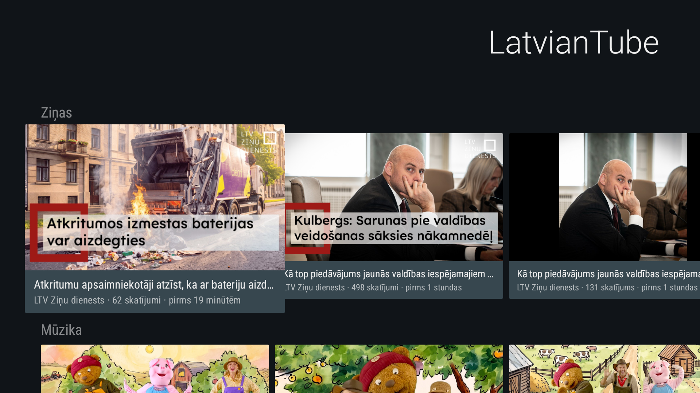
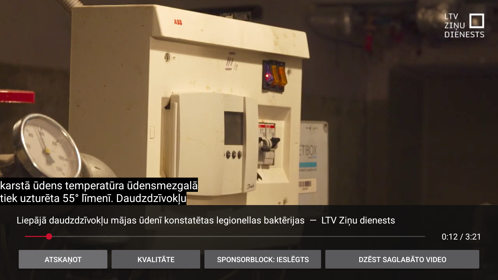

# LatvianTube

**Android TV lietotne YouTube video atlasei latviešu valodā.**

**[Lejupielādēt LatvianTube v1.1 APK](https://github.com/mynetfreedom/LatvianTube/releases/download/v1.1/LatvianTube_v.1.1.apk)** ·
[Laidiena lapa](https://github.com/mynetfreedom/LatvianTube/releases/tag/v1.1) ·
[English summary](README.en.md)

## English — short summary

LatvianTube is a free, open-source Android TV client focused on Latvian-language
YouTube videos. It combines a scored language filter with 17 curated channels,
native Media3 / ExoPlayer playback, quality selection, optional SponsorBlock,
and explicit offline saves. No account or Google Play Services is required.
Inspired by SmartTube's architecture, it uses NewPipeExtractor for media extraction.
The filter infers language from metadata; it does not verify spoken audio.
Full documentation follows in Latvian. APK distribution is GPL-3.0-or-later;
original LatvianTube source retains its MIT license.



## Kas ir LatvianTube?

LatvianTube ir bezmaksas, atvērtā koda lietotne Android TV televizoriem un TV
uztvērējiem. Tā atlasa latviešu valodas YouTube saturu, lai sākumlapā un meklēšanā
nebūtu jāpārlūko viss YouTube piedāvājums. Saskarne ir latviska arī tad, ja
televizora sistēmas valoda ir cita.

Lietotne ir rakstīta Java, paredzēta **Android TV 5.0+ (API 21)** un neprasa Google
Play pakalpojumus vai YouTube kontu. Tajā nav pieteikšanās, abonementu vai
skatīšanās vēstures. Arhitektūras paraugs ir
[SmartTube](https://github.com/yuliskov/SmartTube); SmartTube kods nav pārkopēts.
Video iegūšanai tiek izmantots
[NewPipeExtractor v0.26.5](https://github.com/TeamNewPipe/NewPipeExtractor/tree/v0.26.5).

## Kas jauns v1.1?

- WebView un YouTube iegultais atskaņotājs aizstāti ar **Media3 / ExoPlayer**.
- Iespējams izvēlēties video kvalitāti un kodeku, saglabājot atskaņošanas pozīciju.
- D-pad vadība, atskaņošana/pauze, pāriešana uz citu video vietu un latviešu subtitri.
- Izvēles **SponsorBlock** integrācija sponsorēto daļu izlaišanai.
- Atsevišķu video **saglabāšana bezsaistē** kopā ar audio un pieejamajiem subtitriem.
- Tīkla instalācijas skripts `install-tv.sh` ar precīzu televizora izvēli.
- APK nosaukums **`LatvianTube_v.1.1.apk`**; lietotnes versija **1.1**, versijas kods **2**.

## Lejupielāde

**[Tiešā APK lejupielāde — LatvianTube_v.1.1.apk](https://github.com/mynetfreedom/LatvianTube/releases/download/v1.1/LatvianTube_v.1.1.apk)**

Laidiena lapā ir APK, SHA-256 kontrolsumma, projekta pirmkods un izmantotā
NewPipeExtractor pirmkoda arhīvs. APK ir parakstīts ar pašreizējās projekta
atkļūdošanas būves atslēgu. Privātā parakstīšanas atslēga nav iekļauta repozitorijā.
Atjaunināšana pāri esošai instalācijai darbojas, ja parakstīšanas atslēgas sakrīt.

## Instalēšana televizorā

### Pa lokālo tīklu ar ADB

Datoram un televizoram jābūt vienā tīklā. Televizorā ieslēdziet izstrādātāja
opcijas un tīkla ADB atkļūdošanu. Ja opcijas ir paslēptas, sistēmas informācijas
sadaļā vairākkārt nospiediet Android būves numuru. Televizora iestatījumos
atrodiet tā faktisko IP adresi; zemāk ir piemērs ar `192.168.xx.xxx`.

```bash
cd ~/Desktop/LatvianTube

# Uzbūvēt jaunāko APK, instalēt un atvērt lietotni
./install-tv.sh 192.168.xx.xxx

# Ātrākais variants, ja APK jau ir uzbūvēts
./install-tv.sh 192.168.xx.xxx --no-build
```

Apstipriniet televizorā redzamo **Allow / Atļaut** atkļūdošanas pieprasījumu.
Skripts atrod lokālo `adb`, izmanto tikai norādīto televizoru un instalē ar
`adb install -r`, saglabājot lietotnes datus. `--no-launch` instalē bez lietotnes
atvēršanas; `--help` rāda visas iespējas. Skripts automātiski neatinstalē esošo
lietotni, ja tās parakstīšanas atslēga atšķiras.

Ja ADB ziņo `No route to host`, lai gan TV ports ir sasniedzams, var izmantot
atsevišķu lokālo ADB serveri:

```bash
LATVIANTUBE_ADB_SERVER_PORT=5038 ./install-tv.sh 192.168.xx.xxx --no-build
```

Ja autorizācijas pieprasījums neparādās, televizora izstrādātāja opcijās izslēdziet
un atkal ieslēdziet USB atkļūdošanu, tad atkārtojiet savienošanu.

Televizoros ar bezvadu atkļūdošanas savienošanas kodu izmantojiet atsevišķos
savienošanas un pieslēgšanās portus, ko parāda televizors:

```bash
./install-tv.sh 192.168.xx.xxx:CONNECT_PORT --pair 192.168.xx.xxx:PAIR_PORT --no-build
```

`CONNECT_PORT` un `PAIR_PORT` jāaizstāj ar īstiem skaitļiem. Pēc pieprasījuma
ievadiet televizorā redzamo savienošanas kodu. Ja TV nav tīkla ADB opcijas,
porta 5555 ieslēgšanai var būt vajadzīgs sākotnējs USB savienojums un
`adb tcpip 5555`. Plašāk:
[Android ADB dokumentācija](https://developer.android.com/tools/adb).

### Jau lejupielādēta APK instalēšana

Lejupielādējiet APK datorā, atveriet termināli mapē, kur tas saglabāts, un izpildiet:

```bash
adb connect 192.168.xx.xxx
adb -s 192.168.xx.xxx install -r LatvianTube_v.1.1.apk
adb -s 192.168.xx.xxx shell am start -n lv.latviantube/.ui.browse.BrowseActivity
```

## Satura atlase un valodas filtrs

YouTube metadatos nav konsekventi pieejama uzticama video audio valoda.
`defaultAudioLanguage` pārbaudītajās atbildēs trūka, kanāla valsts nebija pieejama,
un kanāla nosaukums pats par sevi negarantē latvisku saturu. Piemēram, pārbaudes
laikā kanāls “Latvijas Ziņas” publicēja krievisku saturu un tika izslēgts.

Tādēļ filtrs vērtē video nosaukumu, pieejamo aprakstu, kanāla nosaukumu un
piederību pārbaudītam kanālam. **Tas ir valodas novērtējums, nevis audio pārbaude.**

| Pazīme | Punkti |
| --- | --- |
| Latviešu diakritiskās zīmes `ā ē ī ū ō ņ ķ ļ ģ` | +4 par katru, līdz +12 |
| Kopīgās diakritiskās zīmes `š ž č` | +2 par katru, līdz +12 |
| Latviešu palīgvārdi, piemēram, *un, ar, kas* | +2 par katru, līdz +12 |
| Kanāls ir pārbaudītajā sarakstā | +6 |
| Kirilica | −25 |
| Krievu palīgvārdi | −3 par katru, līdz −12 |
| Angļu valodas marķieri | −1 par katru, līdz −5 |
| Pieņemšanas slieksnis | vismaz 4 punkti |

Katram atlasītajam video saglabājas lēmuma pazīmes. Tas palīdz izmeklēt kļūdainu
atlasi. Pārbaudīta kanāla bonuss ļauj pieņemt īstus latviešu video ar īsiem
nosaukumiem vai bez diakritiskajām zīmēm.

Sākumlapu veido **17 pārbaudīti kanāli astoņās kategorijās**: Ziņas, Mūzika,
Sports, Virtuve, Komēdija, Izglītība, Kino un Pilsētas. Meklēšana izmanto
`hl=lv` un `gl=LV`, bet tās rezultāti tiek papildus filtrēti, jo YouTube valodas
parametri ietekmē ranžēšanu un negarantē rezultātu valodu.

## Atskaņotāja vadība



- **Atskaņot / Pauze** un tālvadības multivides taustiņi vada video.
- **Pa kreisi / pa labi** uz laika joslas pārvieto pozīciju par 10 sekundēm.
  Ja vadīklas ir paslēptas, šie taustiņi pārvieto pozīciju un parāda vadīklas.
- **Uz augšu / uz leju** parāda paslēptās vadīklas.
- **Atpakaļ** vispirms paslēpj vadīklas, pēc tam atgriežas pārlūkošanā.
- **Kvalitāte** rāda pieejamās izšķirtspējas un kodekus. Noklusējums izvēlas
  saderīgu kvalitāti līdz 720p, ja tāda pieejama, dodot priekšroku AVC.
- Latviešu subtitri tiek ieslēgti, ja video tiem ir pieejams celiņš. Tiek
  izmantots vietējais video attēlošanas slānis un ierīces dekodētāji.

Tiešie video celiņi izmanto fiksētu izvēlēto kvalitāti; noklusējums nepielāgojas
interneta ātrumam. HLS/DASH atskaņošana izmanto ExoPlayer celiņu izvēli.
Pametot lietotni, audio tiek apturēts. Ja mediju URL atgriež HTTP 403 vai 410,
atskaņotājs vienreiz mēģina iegūt jaunu URL un turpināt no tās pašas pozīcijas.

### SponsorBlock

SponsorBlock sākotnēji ir **izslēgts**. Ieslēdzot to, lietotne izlaiž tikai
`sponsor` kategorijas daļas ar darbību `skip`. Pārklājošās daļas tiek apvienotas;
ja pakalpojums nav sasniedzams, video turpina atskaņoties.

Pieprasījums nosūta SponsorBlock pakalpojumam video ID SHA-256 kontrolsummas
pirmos četrus simbolus un savienojuma IP adresi. Lietotne nesūta balsis,
skatījumu statistiku vai jaunas segmentu atzīmes. Licences, avoti un datu
attiecinājums ir pieejami **Kvalitāte → Licences un avoti**, vai ilgāk nospiežot
SponsorBlock pogu.

### Saglabāšana bezsaistē

**Saglabāt bezsaistē** lejupielādē izvēlēto kvalitāti, audio un pieejamos latviešu
subtitrus lietotnes privātajā mapē. Video kļūst pieejams tikai pēc visu failu
pabeigšanas. Viena saglabāšanas pieprasījuma limits ir **2 GiB**, un ierīcē tiek
atstāti vismaz **64 MiB** brīvas vietas.

Saglabātais video tiek izmantots, atkārtoti atverot to no kešotās sākumlapas vai
meklēšanas kartītes. Nav atsevišķas bezsaistes bibliotēkas. **Dzēst saglabāto video**
izdzēš lokālo kopiju; ja tā tobrīd tiek atskaņota, lietotne mēģina video ielādēt
no tīkla. Aizverot atskaņošanas ekrānu, nepabeigta saglabāšana tiek atcelta un
netiek atsākta. Tiešraides un HLS/DASH saglabāšana nav atbalstīta. Video faili
netiek iekļauti Android mākoņa dublēšanā vai ierīces pārsūtīšanā.

## Uzbūvēšana no pirmkoda

Nepieciešams **JDK 17**, Android SDK **platforma 34** un **build-tools 34.0.0**.
Gradle 8.4 apvalks ir iekļauts projektā. Atkarības tiek iegūtas no Google Maven,
Maven Central un JitPack; NewPipeExtractor ir piesaistīts versijai v0.26.5.

```bash
git clone https://github.com/mynetfreedom/LatvianTube.git
cd LatvianTube
printf 'sdk.dir=%s\n' "$HOME/Library/Android/sdk" > local.properties
./gradlew testDebugUnitTest assembleDebug lintDebug
```

Linux vidē `local.properties` norādiet sava SDK atrašanās vietu, piemēram,
`$HOME/Android/Sdk`. `JAVA_HOME` jānorāda uz JDK 17, ja tas nav noklusējuma JDK.

APK atrodas **`app/build/outputs/apk/debug/LatvianTube_v.1.1.apk`**. Ar citu
atkļūdošanas atslēgu uzbūvēts APK nevarēs atjaunināt iepriekšējo instalāciju.
`local.properties`, privātās atslēgas un būves faili netiek glabāti Git.

Lokāli pieejamu rīku komplektu var norādīt ar `LATVIANTUBE_TOOLCHAIN`. Skripti
atpazīst projekta `.cache/toolchain`, blakus esošo `.cache/toolchain` un šajā Mac
saglabāto `Desktop/FirmenD/.cache/toolchain`. Lai izmantotu sagatavotu TV emulatoru:

```bash
./run-tv.sh
```

## Pārbaudes un pierādījumi

```bash
# Deterministiskie testi, APK un Android lint
./gradlew testDebugUnitTest assembleDebug lintDebug
python3 tools/validate_project.py

# Izvēles tests pret īstu YouTube: iegūšana, mediju baiti un pilna saglabāšana
LATVIANTUBE_LIVE_TESTS=1 ./gradlew testDebugUnitTest

# Valodas filtra un kanālu pārbaude pret dzīviem datiem
node tools/evaluate.mjs
node tools/verify-registry.mjs
```

Deviņi deterministiskie JVM testi pārbauda HTTP transportu, novirzīšanu,
pieprasījumu limitus, SponsorBlock intervālus, pilnīgu bezsaistes saglabāšanu,
bojātus/nepilnīgus failus un ID validāciju. Atsevišķs izvēles tests izmanto īstu
YouTube, tāpēc tā iznākums ir atkarīgs no tīkla un pakalpojuma pieejamības.

Vietējā atskaņošana, kvalitātes izvēle, latviešu subtitri un lokāli saglabāta video
atvēršana pārbaudīti Android TV 14 emulatorā. Vietējā atskaņotāja būve arī
instalēta un atvērta īstā televizorā pa tīkla ADB. Tas vēl nav ilgstošas
atskaņošanas vai veiktspējas mērījums uz fiziska TV.

Iepriekšējās WebView būves veiktspējas mērījumi uz Grundig Android 11 televizora
ir vēsturiski un nepierāda jaunā atskaņotāja veiktspēju. Pilns izpētes un
pārbaudes ieraksts: [ANALYSIS.md](ANALYSIS.md). Valodas filtra mērījumi:
[tools/REPORT.md](tools/REPORT.md).

## Projekta uzbūve

```text
LatvianTube/
├── README.md                  pilna dokumentācija latviski
├── README.en.md               īss kopsavilkums angliski
├── ANALYSIS.md                izpētes un pārbaužu pierādījumi
├── THIRD_PARTY.md             atkarības, licences un izplatīšana
├── install-tv.sh              instalēšana televizorā pa tīklu
├── run-tv.sh                  sagatavota Android TV emulatora palaišana
├── app/src/main/
│   ├── assets/channels_lv.json pārbaudīto kanālu saraksts
│   ├── assets/licenses/       paziņojumi un licenču teksti
│   ├── java/lv/latviantube/
│   │   ├── data/              InnerTube, filtrs, kešatmiņa un mediju iegūšana
│   │   └── ui/                pārlūkošana, meklēšana un vietējais atskaņotājs
│   └── res/                   saskarne un latviešu pamatresursi
├── app/src/test/              JVM testi
└── tools/                     Node/Python pārbaudes
```

Visi pārlūkošanas un meklēšanas rezultāti iet caur `ContentRepository` un valodas
filtru. Mediju iegūšana, JSON apstrāde un failu darbs notiek ārpus galvenā
saskarnes pavediena. `PlayerEngine` atdala saskarni no atskaņotāja ieviešanas.

Lai pievienotu kanālu, izmainiet `channels_lv.json`, palaidiet
`node tools/verify-registry.mjs` un saglabājiet to tikai tad, ja vismaz 80% no
pārbaudītajiem jaunākajiem video iztur filtru. Izslēgtie kanāli un iemesli
atrodas tajā pašā JSON failā.

## Zināmie ierobežojumi

1. Filtrs nepārbauda runāto audio. Latvisks nosaukums virs cita audio var izturēt filtru.
2. Atlase ir atkarīga no kanālu saraksta un meklēšanas; tā neaptver visu latvisko YouTube saturu.
3. YouTube “Trending” galapunkts pārbaudes laikā nebija izmantojams, tāpēc šādas rindas nav.
4. YouTube parakstu, klientu vai piekļuves izmaiņām var būt vajadzīgs NewPipeExtractor atjauninājums.
5. Konta, vecuma, reģiona un botu pārbaudes ierobežojumi var nepieļaut konkrēta video atskaņošanu.
6. SmartTube SABR, automātiska kadru ātruma pārslēgšana, PiP un pilna SmartTube funkciju atbilstība nav ieviesta.
7. HLS/DASH ieviešana nav atsevišķi pārbaudīta šajā testu ciklā; bezsaistes saglabāšana darbojas tikai tiešiem pieprasījuma video celiņiem.
8. Jaunā atskaņotāja veiktspēja uz fiziska TV un darbība API 21 ierīcē vēl jāpārbauda.

## Privātums un licences

Lietotne neprasa kontu. Tā nosūta YouTube pieprasījumus satura un mediju
saņemšanai, lokāli glabā kešatmiņu un pēc pieprasījuma saglabā video.
SponsorBlock ir izvēles pakalpojums ar iepriekš aprakstītu datu nosūtīšanu.

LatvianTube oriģinālais pirmkods saglabā [MIT licenci](LICENSE).
**APK, kas satur NewPipeExtractor, tiek izplatīts ar GPL-3.0-or-later noteikumiem.**
Pilns GPL teksts ir iekļauts lietotnē; precīzu atkarību pirmkoda avoti un
izplatīšanas prasības ir [THIRD_PARTY.md](THIRD_PARTY.md). SponsorBlock dati ir
Ajay Ramachandran un kopienas darbs ar CC BY-NC-SA 4.0 licenci.

LatvianTube ir neatkarīgs projekts, kas nav saistīts ar YouTube vai Google.
InnerTube ir nedokumentēta saskarne, un tās izmantošana var būt pretrunā ar
YouTube lietošanas noteikumiem. Projekts paredzēts personīgai un izglītojošai
lietošanai; video netiek pārpublicēti vai izplatīti citiem.
